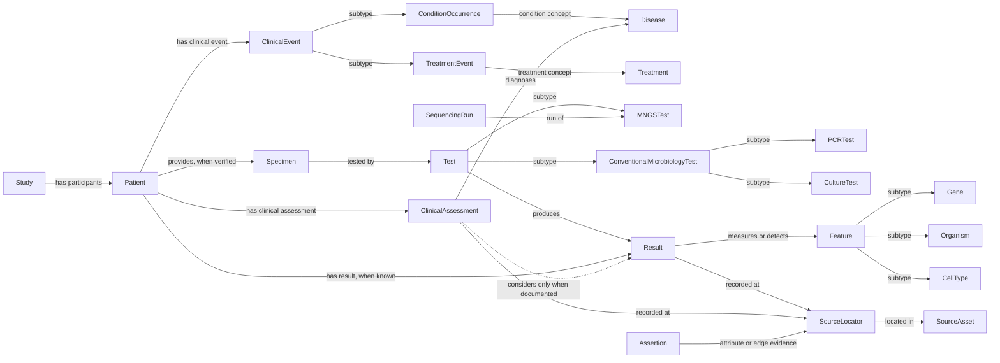
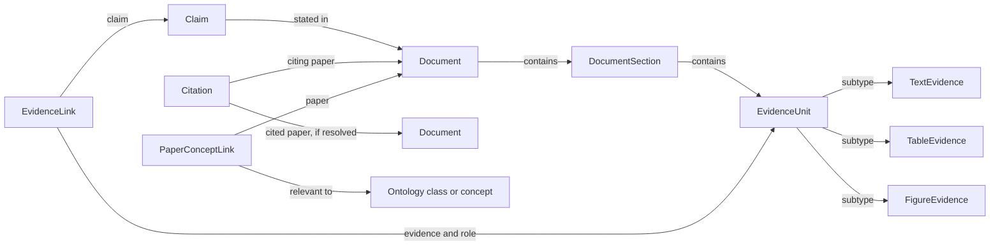

# Ontology v2 cho 5 nguồn Table 1 — bản trình bày và mapping

Ngày: 20/10/2026. Phiên bản: 0.2.0-draft. Phạm vi đúng nhiệm vụ trong bản tóm tắt Zoom ngày 07/10: Dryad HCT BAL, PRJNA984933, PRJNA808886, PRJNA1056765 và PMC Open Access. All of Us/N3C không được thêm vào phạm vi lần này.

**Danh mục v2:** 75 classes (gồm lớp gốc và lớp thiết kế), 41 loại quan hệ, 56 attributes; 255 dòng mapping cấu trúc/trường nguồn, trong đó 90 trường được giữ raw, chưa chuẩn hóa ý nghĩa.

## 1. Anh cần trình bày gì

Bộ khung 8 entity ban đầu được mở rộng theo **hợp của các khái niệm** tìm được ở 5 nguồn, không chỉ phần giao nhau. Bản v2 gồm factual layer, lớp provenance, citation/concept linking và schema cho evidence layer. Đây là ontology domain ở mức draft dựa trên tài sản đã khám phá, không phải tuyên bố đã liệt kê mọi thực thể trong mọi PDF.

Factual layer biểu diễn các dữ liệu được dataset ghi nhận, nhưng vẫn giữ sai số, conflict và trạng thái chưa xác minh. Evidence layer giữ claims/hypotheses/findings được quy cho tác giả, không biến chúng thành sự thật tuyệt đối. Theo Zoom, extraction claim chi tiết là bước sau khi kiểm tra chất lượng ontology và citation/concept network; các class Claim/EvidenceLink ở đây mới chuẩn bị cấu trúc.

JSON-LD/Turtle là hai cách serialize cùng RDF ontology gồm OWL classes, subClassOf, object properties và datatype properties. Đây không phải JSON thông thường đặt tên file .jsonld. Namespace example.org là namespace tạm, cần thay bằng URI của dự án trước khi công bố. Chưa tuyên bố tương đương các concept với ontology y sinh ngoài.

## 2. Điều chỉnh so với Prisma 8 bảng

- Giữ Study, Patient, Specimen (tên cũ Sample), Test, Result, ClinicalAssessment (tên cũ Assessment), ClinicalEvent và nguồn dữ liệu.
- Tách loại xét nghiệm: sequencing/mNGS/host transcriptome và CMT/PCR/culture/microscopy/antigen. Blood/PleuralFluid/Swab được thêm từ methods PRJNA984933; đó là loại mẫu được mô tả, không phải tự tạo mẫu cho mọi bệnh nhân.
- Tách Gene, Organism, CellType, ChromosomalFeature và các feature QC. Tên organism không tự trở thành pathogen.
- Tách Disease/Treatment dùng chung khỏi ConditionOccurrence/TreatmentEvent của từng người. Đây là cách nhiều người cùng liên quan một bệnh/điều trị mà không chia sẻ cùng clinical event.
- Thêm SequencingRun, ProcessingPipeline, DataMatrix, AggregateStatistic và cohort group để giữ các cấu trúc riêng từng dataset.
- Tách SourceAsset, SourceLocator và Assertion để truy vết đến từng thuộc tính hoặc cạnh; một FK Source ở Patient không đủ chứng minh mọi thuộc tính.
- Thêm Document/Section/Evidence/Claim/Citation và PaperConceptLink. PaperConceptLink là N–N paper ↔ ontology concept theo Zoom; khác Citation là trích dẫn thực sự.

Ontology không bắt buộc mỗi class là một bảng SQL. PCRTest subClassOf Test nghĩa là một lần PCR cũng là một Test; không phải thêm một node Test riêng rồi nối một node PCRTest riêng cho cùng lần xét nghiệm.

## 3. Phân cấp khái niệm

### factual

| Class | Parent | Ý nghĩa | Căn cứ |
|---|---|---|---|
| Study | Entity | Nghiên cứu/cohort; không đồng nhất với repository hay bài báo. | D1,D2,D3,D4; source-grounded |
| CohortGroup | Entity | Nhóm thuộc một nghiên cứu; giữ mẫu số và tiêu chí phân nhóm. | D2,D3,D4; source-grounded |
| Patient | Entity | Người tham gia có mã trong phạm vi study; không tự ghép người giữa nghiên cứu. | D1,D2,D3,D4; source-grounded |
| ClinicalEvent | Entity | Sự kiện hoặc ghi nhận lâm sàng cụ thể của một người. | D2,D3,D4; source-grounded |
| ConditionOccurrence | ClinicalEvent | Ghi nhận bệnh nền/chẩn đoán cho một người; khác với concept bệnh dùng chung. | D2,D3,D4; source-grounded |
| SymptomOccurrence | ClinicalEvent | Ghi nhận triệu chứng như sốt, ho, khó thở. | D2; source-grounded |
| TreatmentEvent | ClinicalEvent | Can thiệp/điều trị được nguồn mô tả cho một người; không tự suy thời gian. | D2,D3; source-grounded |
| TransplantEvent | TreatmentEvent | Sự kiện HCT/HSCT khi có ghi nhận; không tự điền ngày. | D2; source-grounded |
| CARTTreatmentEvent | TreatmentEvent | Sự kiện CAR-T được mô tả trong nguồn. | D2; source-grounded |
| DrugTreatmentEvent | TreatmentEvent | Điều trị bằng thuốc; giữ nguyên ý nghĩa kê đơn/đã dùng nếu nguồn có. | D2; source-grounded |
| ImagingFinding | ClinicalEvent | Mô tả hình ảnh phổi; không tự coi là kết quả vi sinh. | D2; source-grounded |
| Specimen | Entity | Mẫu sinh học thực tế; Sample là tên cũ tương ứng. | D1,D2,D3,D4; source-grounded |
| BALSpecimen | Specimen | Mẫu dịch rửa phế quản-phế nang. | D1,D2,D3,D4; source-grounded |
| BloodSpecimen | Specimen | Mẫu máu được mô tả ở methods; chưa có liên kết từng người từ methods. | D2; source-grounded |
| PleuralFluidSpecimen | Specimen | Mẫu dịch màng phổi nêu trong methods; không tự tạo specimen cá nhân. | D2; source-grounded |
| SwabSpecimen | Specimen | Mẫu swab nêu trong methods; giữ nguyên loại nguồn, không tự sửa vị trí lấy. | D2; source-grounded |
| Test | Entity | Một lần thực hiện xét nghiệm/assay, khác với tên phương pháp dùng chung. | D1,D2,D3,D4; source-grounded |
| SequencingTest | Test | Assay dùng giải trình tự. | D1,D2,D3,D4; source-grounded |
| MNGSTest | SequencingTest | Assay metagenomic next-generation sequencing. | D2,D3,D4; source-grounded |
| HostTranscriptomeTest | SequencingTest | Assay/processing tạo biểu hiện gene chủ; cần chứng cứ về mẫu và pipeline. | D1,D4; source-grounded |
| ConventionalMicrobiologyTest | Test | Xét nghiệm vi sinh thông thường; CMT tổng quát không tự suy thành PCR/culture. | D2,D3; source-grounded |
| PCRTest | ConventionalMicrobiologyTest | PCR được mô tả trong methods; chỉ gán cá nhân khi có kết quả tương ứng. | D2; source-grounded |
| CultureTest | ConventionalMicrobiologyTest | Nuôi cấy vi khuẩn/nấm được nêu ở methods. | D2; source-grounded |
| MicroscopyTest | ConventionalMicrobiologyTest | Soi/smear microscopy được nêu trong methods. | D2; source-grounded |
| AntigenTest | ConventionalMicrobiologyTest | Ví dụ galactomannan; không tự đồng nhất với PCR. | D2; source-grounded |
| LaboratoryTest | Test | Xét nghiệm chỉ số xét nghiệm; có thể mới được mô tả ở cấp nhóm. | D2; source-grounded |
| SequencingRun | Entity | Một run SRA; khác patient, specimen và assay. | D2,D3,D4; source-grounded |
| ProcessingPipeline | Entity | Pipeline/phần mềm/reference dùng tạo kết quả dẫn xuất. | D1,D4; source-grounded |
| Result | Entity | Một kết quả/observation với giá trị, đơn vị, loại phép đo và trạng thái. | D1,D2,D3,D4; source-grounded |
| MicrobialDetection | Result | Phát hiện tác nhân/taxon; chưa đồng nghĩa gây bệnh. | D2,D3,D4; source-grounded |
| GeneCountResult | Result | Count gắn gene và người/mẫu; không phải số bản sao gene trong DNA. | D1,D4; source-grounded |
| TaxonAbundanceResult | Result | Abundance theo taxon; giữ công thức/đơn vị chưa biết. | D4; source-grounded |
| CoverageResult | Result | Độ bao phủ; cần định nghĩa metric và đơn vị từ nguồn. | D3; source-grounded |
| CNVResult | Result | Feature CNV hoặc tumor fraction dẫn xuất; không phải gene expression. | D4; source-grounded |
| CellTypeScoreResult | Result | Score cell type CIBERSORTx; không tự xem là phần trăm. | D4; source-grounded |
| QualityMetricResult | Result | QC như Q20, Q30, clean rate, RMSE; gắn đúng đối tượng run/pipeline. | D4; source-grounded |
| LaboratoryResult | Result | Kết quả chỉ số như WBC/ANC nếu có giá trị cá nhân; số nhóm lưu AggregateStatistic. | D2; source-grounded |
| ClinicalAssessment | Entity | Đánh giá lâm sàng cho người/episode, thời điểm và cách adjudicate. | D2,D3,D4; source-grounded |
| DiagnosticAssessment | ClinicalAssessment | Chẩn đoán, infection status và mức chắc chắn theo đánh giá nguồn. | D2,D3,D4; source-grounded |
| CoinfectionAssessment | DiagnosticAssessment | Đồng nhiễm được nguồn đánh giá, không tự suy từ số taxon phát hiện. | D3; source-grounded |
| InfectionEpisode | Entity | Đợt bệnh để nhóm nhiều tác nhân; chỉ tạo khi xác định được ranh giới episode. | D3; design |

### concept

| Class | Parent | Ý nghĩa | Căn cứ |
|---|---|---|---|
| Feature | Entity | Đối tượng/đại lượng được đo; định danh namespace và cấp phân loại. | D1,D2,D3,D4; source-grounded |
| Gene | Feature | Gene concept; ENSG và gene symbol chưa được coi tương đương khi chưa mapping. | D1,D4; source-grounded |
| Organism | Feature | Taxon/vi sinh vật concept; không mặc định là pathogen. | D2,D3,D4; source-grounded |
| Bacterium | Organism | Taxon vi khuẩn khi có phân loại được xác minh. | D2,D3,D4; source-grounded |
| Virus | Organism | Taxon virus; ví dụ TTV, HHV6B trong nguồn. | D2,D3; source-grounded |
| Fungus | Organism | Taxon nấm khi có phân loại được xác minh. | D2,D3,D4; source-grounded |
| CellType | Feature | Loại tế bào được pipeline ước lượng. | D4; source-grounded |
| ChromosomalFeature | Feature | Feature nhiễm sắc thể/CNV. | D4; source-grounded |
| LaboratoryAnalyte | Feature | Chỉ số xét nghiệm như WBC, ANC, CRP, PCT. | D2; source-grounded |
| QualityMetric | Feature | Đại lượng QC như Q20, GC, correlation và RMSE. | D4; source-grounded |
| Disease | Entity | Khái niệm bệnh dùng chung; một occurrence cụ thể mới thuộc người. | D2,D3,D4; source-grounded |
| Treatment | Entity | Khái niệm điều trị dùng chung; không phải sự kiện điều trị từng người. | D2,D3; source-grounded |

### aggregate

| Class | Parent | Ý nghĩa | Căn cứ |
|---|---|---|---|
| AggregateStatistic | Entity | Giá trị ở cấp nhóm, có mẫu số; không gán cho cá nhân. | D2,D3; source-grounded |
| DiagnosticPerformanceStatistic | AggregateStatistic | Sensitivity/specificity hoặc bảng đồng thuận; giữ reference standard. | D2,D3; source-grounded |

### provenance

| Class | Parent | Ý nghĩa | Căn cứ |
|---|---|---|---|
| SourceAsset | Entity | File hoặc phiên bản nguồn, URI/checksum/license/retrieval status. | D1,D2,D3,D4,D5; source-grounded |
| DataMatrix | SourceAsset | Ma trận có hướng hàng/cột, namespace feature và modality. | D1,D4; source-grounded |
| SourceLocator | Entity | Vị trí chính xác: sheet/row/column, XML ID/XPath hoặc trang PDF đã xác minh. | D1,D2,D3,D4,D5; source-grounded |
| Assertion | Entity | Phát biểu có subject/predicate/object hoặc literal và nguồn; dùng truy vết từng thuộc tính/cạnh. | design; design |
| Identifier | Entity | Mã external có namespace; BioSample/run/PMCID là các namespace khác nhau. | D1,D2,D3,D4,D5; source-grounded |
| LinkageRecord | Entity | Liên kết ứng viên giữa hai entity với trạng thái verified/unresolved/conflict. | D2,D3,D4; design |

### evidence

| Class | Parent | Ý nghĩa | Căn cứ |
|---|---|---|---|
| Document | SourceAsset | Bài báo/tài liệu có định danh và nội dung theo phiên bản. | D5; source-grounded |
| DocumentSection | Entity | Section của tài liệu: methods/results/...; giữ nhãn nguồn. | D5; source-grounded |
| EvidenceUnit | Entity | Đoạn, bảng, hình hoặc cell dùng làm evidence; không tự xác thực claim. | D5; source-grounded |
| TextEvidence | EvidenceUnit | Đoạn văn có vị trí trong phiên bản tài liệu. | D5; source-grounded |
| TableEvidence | EvidenceUnit | Bảng hoặc vùng ô; có header và phạm vi. | D5; source-grounded |
| FigureEvidence | EvidenceUnit | Hình/caption; chưa đồng nghĩa đã extract giá trị ảnh. | D5; source-grounded |
| Claim | Entity | Phát biểu được quy cho tác giả/tài liệu, giữ ngữ cảnh/độ chắc chắn. | D5; design |
| Hypothesis | Claim | Giả thuyết của bài; không phải fact được xác nhận. | D5; design |
| MethodClaim | Claim | Phát biểu về phương pháp nghiên cứu. | D5; design |
| FindingClaim | Claim | Phát biểu về kết quả nghiên cứu. | D5; design |
| EvidenceLink | Entity | Mapping claim/evidence với role supports/contradicts/contextualizes. | Zoom; design |

### citation

| Class | Parent | Ý nghĩa | Căn cứ |
|---|---|---|---|
| Citation | Entity | Record trích dẫn có paper nguồn, reference text và target nếu resolve được. | D5; source-grounded |
| PaperConceptLink | Entity | Mapping N–N paper/concept, relevance và nguồn; không đồng nghĩa citation. | Zoom; design |

### shared

| Class | Parent | Ý nghĩa | Căn cứ |
|---|---|---|---|
| Entity | — | Lớp gốc cho record và concept; không phải bảng phải nhập dữ liệu. | design; design |

## 4. Attributes (mỗi dòng một thuộc tính)

Các thuộc tính dưới đây là danh mục áp dụng, không phải tất cả bắt buộc. Mỗi node có IRI định danh; FK/PK là triển khai quan hệ, không phải cú pháp OWL. Thiếu thuộc tính trong graph không đồng nghĩa giá trị false/zero.

- `label` — string; áp dụng: Entity. Tên gốc/nhãn dễ đọc
- `sourcePatientId` — string; áp dụng: Patient. Mã người trong study; khóa logic study+sourcePatientId
- `age` — decimal; áp dụng: Patient. Tuổi như nguồn; lưu tuổi cùng thời điểm nếu có
- `sex` — string; áp dụng: Patient. Giá trị giới nguyên gốc
- `description` — string; áp dụng: Entity. Nội dung mô tả nguồn
- `sourceUrl` — anyURI; áp dụng: SourceAsset,Study. Link nguồn
- `localPath` — string; áp dụng: SourceAsset. Đường dẫn file bản cục bộ
- `namespace` — string; áp dụng: Identifier,Feature. Namespace mã
- `accession` — string; áp dụng: Identifier. Accession nguyên gốc
- `taxonRank` — string; áp dụng: Organism. Genus/species/unknown; không ép rank
- `modality` — string; áp dụng: Test,DataMatrix. DNA/RNA/unknown theo nguồn
- `platform` — string; áp dụng: Test,SequencingRun. Tên platform theo từng nguồn; giữ conflict
- `libraryLayout` — string; áp dụng: SequencingRun. SINGLE/PAIRED theo RunInfo
- `librarySource` — string; áp dụng: SequencingRun. METAGENOMIC/METATRANSCRIPTOMIC...
- `numericValue` — double; áp dụng: Result,AggregateStatistic. Giá trị số; không tự đổi unit hoặc missing thành zero
- `textValue` — string; áp dụng: Result. Giá trị chữ nguyên gốc
- `unit` — string; áp dụng: Result,AggregateStatistic. Đơn vị nguồn; unknown khi chưa xác minh
- `measurementType` — string; áp dụng: Result. read_count/gene_count/coverage/abundance/score/...
- `resultStatus` — string; áp dụng: Result. detected/negative/not_performed/not_collected/not_reported/unknown; zero là giá trị riêng
- `infectionStatus` — string; áp dụng: ClinicalAssessment. infectious/noninfectious/unknown/mixed theo adjudication nguồn
- `certainty` — string; áp dụng: ClinicalAssessment,Claim. Độ chắc chắn nguồn; không phải extraction confidence
- `assessmentStage` — string; áp dụng: ClinicalAssessment. initial/interim/final/unknown; chỉ gán nếu xác minh
- `assessmentMethod` — string; áp dụng: ClinicalAssessment. Clinician review/reference criteria theo nguồn
- `diagnosticClassification` — string; áp dụng: ClinicalAssessment. True-negative/false-negative/... theo reference được báo cáo
- `startTime` — dateTime; áp dụng: ClinicalEvent,Test,InfectionEpisode. Thời điểm bắt đầu nếu có đủ độ chính xác
- `endTime` — dateTime; áp dụng: ClinicalEvent,Test,InfectionEpisode. Thời điểm kết thúc
- `eventTime` — dateTime; áp dụng: Result,ClinicalAssessment. Thời điểm kết quả/đánh giá nếu biết
- `collectionTime` — dateTime; áp dụng: Specimen. Ngày giờ lấy mẫu nếu có
- `rawTime` — string; áp dụng: Entity. Ngày/khoảng thời gian nguyên văn khi chưa đủ để ép DateTime
- `dateStatus` — string; áp dụng: Entity. original/shifted/generalized/relative/unknown
- `isControl` — boolean; áp dụng: Specimen. true/false chỉ khi xác minh; không có thuộc tính là chưa rõ
- `controlRole` — string; áp dụng: CohortGroup,Specimen. Vai trò control theo nguồn
- `fileFormat` — string; áp dụng: SourceAsset. CSV/XLSX/JATS/BioC/ZIP/...
- `checksum` — string; áp dụng: SourceAsset. SHA256 của file thực tế
- `version` — string; áp dụng: SourceAsset,ProcessingPipeline. Phiên bản
- `license` — string; áp dụng: SourceAsset. License được ghi nhận; không đoán
- `retrievalStatus` — string; áp dụng: SourceAsset. available/blocked/unusable/unknown
- `retrievedAt` — dateTime; áp dụng: SourceAsset. Thời gian lấy file nếu biết
- `locator` — string; áp dụng: SourceLocator. Sheet/row/column hoặc XML ID/XPath; không coi BioC offset là PDF page
- `rawText` — string; áp dụng: SourceLocator,EvidenceUnit,Claim. Nguyên văn
- `predicateIri` — anyURI; áp dụng: Assertion. IRI predicate được phát biểu; không phải một class disease
- `literalValue` — string; áp dụng: Assertion. Literal nguyên gốc của phát biểu nếu không có assertionObject
- `mappingStatus` — string; áp dụng: Entity. verified/unresolved/conflict/unmapped; không tự tạo equivalence
- `extractionStatus` — string; áp dụng: Entity. human_verified/auto_extracted/review_required/template
- `extractionConfidence` — double; áp dụng: Assertion,PaperConceptLink. Độ tin cậy extraction nếu đo được; không bịa score
- `evidenceRole` — string; áp dụng: EvidenceLink. supports/contradicts/contextualizes
- `referenceText` — string; áp dụng: Citation. Reference nguyên văn khi chưa resolve
- `relevanceReason` — string; áp dụng: PaperConceptLink. Lý do paper liên quan concept; không phải citation
- `denominator` — integer; áp dụng: AggregateStatistic. Mẫu số thống kê
- `sampleSize` — integer; áp dụng: AggregateStatistic,CohortGroup. Số người/mẫu với counting unit
- `countingUnit` — string; áp dụng: AggregateStatistic,CohortGroup. patient/specimen/run/...
- `rowAxis` — string; áp dụng: DataMatrix. Ý nghĩa rows
- `columnAxis` — string; áp dụng: DataMatrix. Ý nghĩa columns
- `referenceBuild` — string; áp dụng: ProcessingPipeline. Genome/annotation build
- `software` — string; áp dụng: ProcessingPipeline. Phần mềm và version
- `metadataJson` — string; áp dụng: Entity. JSON nguyên bản cho các metadata chưa chuẩn hóa; không coi là ontology đã giải nghĩa

## 5. Quan hệ và cardinality

Cardinality dưới đây là chính sách nhập liệu đề xuất; không phải OWL constraints đã enforce. Trường thiếu trong extraction giữ unknown thay vì dựng node giả. `N:0..1` nghĩa là mỗi node bên trái có tối đa một đối tượng bên phải đã xác minh; một đối tượng bên phải có thể được nhiều node bên trái tham chiếu.

| Predicate | Từ → đến | Cardinality | Điều kiện |
|---|---|---|---|
| enrolledIn | Patient → Study | N:1 | Exactly one study in pilot identity namespace |
| groupInStudy | CohortGroup → Study | N:1 | Exactly one |
| memberOfGroup | Patient → CohortGroup | N:N | Only source-stated membership |
| eventFor | ClinicalEvent → Patient | N:1 | Required for patient-specific event |
| conditionConcept | ConditionOccurrence → Disease | N:1 | Keep raw label; mapping optional |
| treatmentConcept | TreatmentEvent → Treatment | N:N | Source-grounded |
| specimenFrom | Specimen → Patient | N:0..1 | Do not invent missing patient/sample mapping |
| testedSpecimen | Test → Specimen | N:0..1 | A partial extraction may lack specimen identity |
| runOf | SequencingRun → SequencingTest | N:0..1 | Only verified mapping; conflicts in LinkageRecord |
| resultFor | Result → Patient | N:0..1 | May be unknown; no row-order join |
| producedByTest | Result → Test | N:0..1 | Optional when assay is not identified |
| measures | Result → Feature | N:1 | Exactly one per atomic result when identified |
| generatedBy | Result → ProcessingPipeline | N:N | Only with processing evidence |
| qualityOf | QualityMetricResult → Entity | N:1 | Must name correct target; no fake patient |
| assessmentFor | ClinicalAssessment → Patient | N:1 | Required for patient-level assessment |
| diagnoses | DiagnosticAssessment → Disease | N:N | May be unknown; preserve source wording |
| considersResult | ClinicalAssessment → Result | N:N | Optional; source must identify relationship |
| assessmentOfEpisode | ClinicalAssessment → InfectionEpisode | N:0..1 | Only if episode boundary known |
| episodeFor | InfectionEpisode → Patient | N:1 | Exactly one patient |
| implicatesOrganism | CoinfectionAssessment → Organism | N:N | Not generated from detection count alone |
| statisticForGroup | AggregateStatistic → CohortGroup | N:1 | No copying group values to patients |
| sourceInStudy | SourceAsset → Study | N:N | Optional; paper can describe multiple studies |
| derivedFrom | SourceAsset → SourceAsset | N:N | Pipeline provenance, not citation |
| hasIdentifier | Entity → Identifier | N:N | Identifier namespace required; no automatic owl:sameAs |
| recordedAt | Entity → SourceLocator | N:N | Required provenance for extracted records; do not assert every property from this |
| locatedIn | SourceLocator → SourceAsset | N:1 | Exactly one asset |
| assertionSubject | Assertion → Entity | N:1 | One |
| assertionObject | Assertion → Entity | N:0..1 | Use object or literalValue, not both |
| assertionSource | Assertion → SourceLocator | N:N | At least one for accepted extraction |
| linkFrom | LinkageRecord → Entity | N:1 | One |
| linkTo | LinkageRecord → Entity | N:1 | One; unresolved record is not an established fact |
| sectionOf | DocumentSection → Document | N:1 | One |
| evidenceIn | EvidenceUnit → Document | N:1 | One versioned document |
| evidenceSection | EvidenceUnit → DocumentSection | N:0..1 | When available |
| claimIn | Claim → Document | N:N | Do not promote claim into factual layer without validation |
| linkClaim | EvidenceLink → Claim | N:1 | One |
| linkEvidence | EvidenceLink → EvidenceUnit | N:1 | One; role is an attribute |
| citingDocument | Citation → Document | N:1 | One |
| citedDocument | Citation → Document | N:0..1 | Keep unresolved reference text; never invent DOI |
| linkedPaper | PaperConceptLink → Document | N:1 | One |
| linkedConcept | PaperConceptLink → Entity | N:1 | Class IRI handled via OWL punning; not subclass membership |

### Các quan hệ N–N thật sự cần giữ

- Patient ↔ Disease đi qua ConditionOccurrence: mỗi occurrence của một người, nhiều người cùng disease concept.
- Patient ↔ Treatment đi qua TreatmentEvent.
- Paper ↔ Concept đi qua PaperConceptLink: lưu reason và mapping status; đây là nhiệm vụ concept-level linking của anh.
- Claim ↔ EvidenceUnit đi qua EvidenceLink: có role supports/contradicts/contextualizes, không coi mọi evidence là hỗ trợ.
- ClinicalAssessment ↔ Result là **tùy chọn có điều kiện**, chỉ thêm khi nguồn cho biết assessment xem xét result cụ thể; không tự nối toàn bộ kết quả cùng người.
- CoinfectionAssessment ↔ Organism giữ tác nhân được adjudicate; nhiều detections không tự tạo assessment đồng nhiễm.

Assessment có thể diễn ra trước/trong/sau lúc lấy mẫu. Nhánh riêng là lựa chọn cấu trúc dữ liệu, không nói hai hoạt động độc lập lâm sàng và không biểu diễn thứ tự thời gian.

## 6. Mapping theo từng nguồn

D1 — Dryad: gene → Gene; cột Pt → Patient; từng count → GeneCountResult. File matrix → DataMatrix, mỗi ô có SourceLocator. Không bịa specimen ID/assay ID khi CSV chỉ có mã người.

D2 — PRJNA984933: underlying disease → ConditionOccurrence → Disease; mNGS organism/reads → MicrobialDetection → Organism; Table 2–3 → symptoms/imaging/DiagnosticAssessment/treatment text. PCR/culture/antigen và blood/pleural/swab có căn cứ từ methods, chưa phải dữ liệu từng người. Table 1 → AggregateStatistic. Patient ↔ run vẫn unresolved.

D3 — PRJNA808886: các hàng tiếp tục một bệnh nhân được khôi phục theo nhóm; CMT và mNGS tách kết quả; unique reads và CovRate là loại đo khác nhau. Additional file 2 cho CoinfectionAssessment; không dùng số taxon để suy đồng nhiễm. PT ↔ Wz chưa xác minh; platform conflict giữ theo nguồn.

D4 — PRJNA1056765: group → CohortGroup; BioSample/SRA → Identifier/SequencingRun; Q20/Q30/GC/reads → QualityMetricResult đúng đối tượng; các matrix → GeneCountResult/TaxonAbundanceResult/CNVResult/CellTypeScoreResult. 32 NC mapping DNA/RNA cần review; hai genus matrix chưa tự gán modality; CIBERSORT abs score không tự đổi thành percentage. File species/TE không dùng được vẫn là asset có retrievalStatus=unusable, không tạo observations zero.

D5 — PMC: article → Document; section → DocumentSection; p/table/fig → EvidenceUnit subclasses; ref/xref → Citation. Chưa resolve reference thì chỉ giữ referenceText. PaperConceptLink map paper với ontology concept; relevance edge không tự coi là citation. Claim extraction chi tiết chưa chạy toàn corpus.

`source_field_mapping.csv` kiểm kê từng header đã đọc của các phụ lục, clinical tables và RunInfo, cộng các cấu trúc matrix/XML. Trường chưa giải nghĩa cụ thể được đánh dấu `retained_raw`; không gọi đó là đã chuẩn hóa hoàn toàn. Đây là field-level mapping dự thảo, không phải ETL đã chạy toàn bộ.

## 7. Hai ví dụ KG có dữ liệu thực đã kiểm tra

### Dryad

Patient Pt-01 → enrolledIn → Dryad study.

GeneCountResult → resultFor → Pt-01; → measures → Gene ENSG00000000003; numericValue=45; measurementType=gene_count. Vị trí nguồn: TableS6.csv dòng 4, cột Pt-01. 45 là count reads gắn gene, không phải 45 bản sao gene. Không tạo Sample/Test node không có mã xác minh.

### PRJNA984933 patient 10

MicrobialDetection → measures → Torque teno virus; numericValue=5 reads; → resultFor → patient 10. ClinicalAssessment của cùng người có chẩn đoán từ Table 2 và phân loại true-negative theo nghiên cứu. Hai record đều có nguồn riêng. Không thêm considersResult chỉ vì chúng cùng người. Tên taxon giữ mappingStatus=unmapped, chưa tuyên bố taxonomy ID chuẩn.

Các ví dụ nằm riêng trong examples.jsonld/.ttl, không lẫn với class definitions. Assertion minh họa truy vết cạnh diagnosis đến đúng record Table 2; không biến provenance ở cấp asset thành bằng chứng cho mọi thuộc tính.

## 8. Sơ đồ tiếng Anh

Sơ đồ class-level, không phải một patient instance cụ thể và không phải timeline. Mũi tên `subtype` từ loại rộng xuống loại hẹp là cách đọc hình; RDF thực tế dùng subclass → rdfs:subClassOf → superclass.

### Factual + provenance

### Evidence + citation + concept links

## 9. Quy tắc extraction cho Insiya và mapping của anh

1. Mỗi record giữ study namespace và vị trí nguồn trước khi chuẩn hóa. Patient ID, BioSample và SRA run là các loại định danh khác nhau.
2. Nhận diện grain trước: patient-level, specimen-level, run-level, matrix-cell hay group-level. Không lấy mean của nhóm điền cho từng người.
3. Map vào class cụ thể nhất có chứng cứ. CMT chưa nêu phương pháp thì giữ ConventionalMicrobiologyTest; không tự gọi PCR.
4. Thiếu giá trị, negative, zero, not performed, not collected, continuation và unavailable file không được gộp.
5. Không tự gán nhãn bệnh từ group name nếu bài chưa xác nhận; không tự gọi detection là bệnh nguyên.
6. Không coi một số trong tên PT/Wz là khóa nối. LinkageRecord giữ unresolved/conflict; không xuất cạnh fact chưa xác minh.
7. Mỗi thuộc tính/cạnh được chấp nhận phải có SourceLocator; dùng Assertion khi cần nguồn riêng hoặc conflict. Có thể truy nguồn mọi thông tin được trích mà không ép mọi node giữ cùng FK Source.
8. Claims giữ attribution và loại hypothetical/observational; extraction confidence khác clinical certainty. Không tạo confidence giả.
9. Citation phải dựa trên ref/xref; relevant_to không phải cites. Không tạo DOI hay citation count từ suy đoán LLM.
10. Các date/time chưa rõ độ chính xác giữ rawTime; assessmentStage unknown nếu không biết, không suy từ thứ tự bảng.

## 10. Những câu hỏi ontology cần trả lời được

- Một bệnh nhân có bệnh nền gì, đã lấy mẫu gì, dùng loại xét nghiệm nào?
- Những result nào phát hiện cùng một organism concept, với metric và đơn vị nào?
- Có detection nhưng assessment noninfectious ở đâu? Nguồn cho từng record là gì?
- Mỗi modality DNA/RNA có run, QC và pipeline nào, linkage có conflict không?
- Gene ENSG và gene symbol có mapping đã xác minh không?
- Bài nào liên quan một concept? Vì sao map vào concept đó? Bài nào thực sự trích dẫn bài nào?
- Claim nào có evidence cụ thể, evidence ủng hộ hay phản bác, ở đoạn/bảng nào?

## 11. Trạng thái bàn giao và giới hạn

Đã tạo ontology union draft, class/property/attribute catalogs, source field mapping, sơ đồ và hai ví dụ instance có vị trí nguồn. Có file kiểm tra parse RDF/JSON-LD, đối chiếu hai serialization, kiểm tra class/property refs và các ví dụ. Chưa chạy OWL reasoner hoặc SHACL đầy đủ; cardinality trong CSV là chính sách đề xuất. Không thay đổi Prisma cũ hoặc dữ liệu nguồn.

Chưa: ETL tất cả rows, gold-standard evidence corpus, kiểm tra tất cả PDF, triển khai DB/KG, thu thập khoảng 10 papers/concept hoặc citation network mới. Các việc này là pipeline tiếp theo và cần phối hợp Insiya; không coi các template trống là kết quả retrieval. Hai bài PMC mẫu không đại diện toàn kho PMC. Dryad PDF vẫn chưa mở được. Danh mục hiện tại phải tiếp tục bổ sung khi gặp concept mới.

## 12. Đề cương 6 trang để đưa vào Slides chung

1. Goal: expand initial skeleton into the union of concepts from five sources.
2. Concept hierarchy: specimen/test/result/feature/assessment subclasses; distinguish concept vs occurrence.
3. Factual layer and source mapping: five-source coverage; one-to-many vs many-to-many.
4. Provenance: SourceAsset → SourceLocator; Assertion records evidence for attributes and edges.
5. Evidence/citation layer: Document–Evidence–Claim; paper–concept N–N; citation ≠ relevance.
6. Grounded examples, known mapping conflicts, validation status and division of next steps.

Nội dung đã sẵn để đưa vào Slides; chưa tạo/chia sẻ tài liệu Google Slides hoặc gửi tin nhắn cho người khác.

## 13. Nguồn và căn cứ

- Bản tóm tắt Zoom ngày 07/10 do anh cung cấp: ưu tiên union, subclass, concept linking; là bản AI summary, không thay thế transcript gốc.
- D1: [Dryad dataset](https://datadryad.org/dataset/doi:10.5061/dryad.800tj), file TableS6.csv và metadata địa phương.
- D2: [Frontiers paper](https://www.frontiersin.org/journals/medicine/articles/10.3389/fmed.2023.1195629/full), PRJNA984933 article.xml, supplementary và Tables 1–3 địa phương. Các thuật ngữ methods và hash của đoạn nằm trong methods_evidence.json.
- D3: [BMC paper](https://link.springer.com/article/10.1186/s12879-022-07381-8), hai additional XLSX, Tables 1–3 và RunInfo địa phương.
- D4: [Scientific Data paper](https://www.nature.com/articles/s41597-025-06171-6), S1–S3, Figshare matrices và RunInfo địa phương.
- D5: [PMC9052728](https://pmc.ncbi.nlm.nih.gov/articles/PMC9052728/), [PMC10338636](https://pmc.ncbi.nlm.nih.gov/articles/PMC10338636/), JATS/BioC mẫu địa phương.
- Định dạng tham chiếu: [W3C JSON-LD 1.1](https://www.w3.org/TR/json-ld11/), [W3C OWL 2 Primer](https://www.w3.org/TR/owl2-primer/). Dùng classes, properties và subclass hierarchy; không tuyên bố ontology đã được community-curate.
